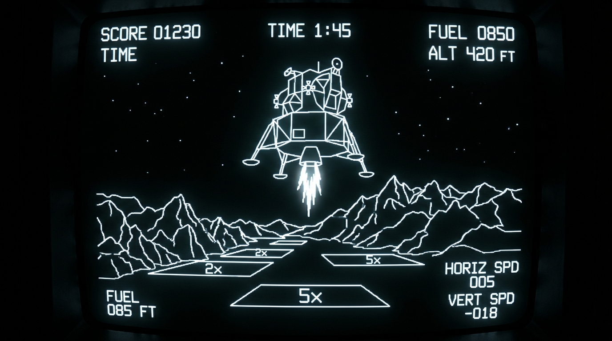

# Lunar Lander (Rust + WebAssembly)



A faithful, zero-dependency **Rust + WebAssembly** implementation of the classic vector-graphics **Lunar Lander** arcade game, reverse-engineered from [moonlander.seb.ly](http://moonlander.seb.ly/).

## History of Lunar Lander

The [Lunar Lander genre](https://en.wikipedia.org/wiki/Lunar_Lander_(video_game_genre)) was inspired by the 1969 Apollo 11 Lunar Module landing:

- **1969 — *Lunar Landing Game* (PDP-8 / FOCAL):** Written by high school student Jim Storer on a DEC PDP-8 minicomputer as a turn-based text simulation where players entered fuel burn amounts per 10-second turn.
- **1973 — *101 BASIC Computer Games*:** David H. Ahl ported Storer's game (alongside *ROCKT1* and *ROCKT2*) to BASIC, making it one of the most widely played early computer games.
- **1973 — *Moonlander* (DEC GT40):** Commissioned by DEC and written by Jack Burness, *Moonlander* was the first real-time graphical version, featuring vector graphics, light-pen throttle/angle control, close-up landing zoom, and even the first video game Easter egg.
- **1979 — *Lunar Lander* (Atari Arcade):** Atari's first vector-graphics arcade cabinet introduced proportional thrust, rotating spacecraft control, a repeating mountainous terrain, bonus landing pad multipliers (`2x`–`5x`), and fuel-for-quarters arcade play.

## Reverse-Engineered Mechanics

From `moonlander.seb.ly`:
- **Physics (60Hz fixed step):** Gravity `0.0005`, main thruster acceleration `0.0015`, horizontal drag `0.9997`, smooth throttle ramp, and `±15°` stepped rotation (`[-90°, 90°]`) with an 80ms cooldown.
- **Infinite Wrapping Terrain:** 157-vertex lunar surface with 11 flat landing pads and 7 cycling `2x`–`5x` multiplier combinations, CRT vector flicker, and procedural starfield.
- **Auto-Zoom Camera:** Automatically transitions to a `5x` close-up landing view when altitude drops below `70` and zooms back out above `160`.
- **Landing & Crash Rules:** Touching down upright (`0°`) within a flat pad at vertical speed `< 0.075` awards a **Perfect Landing** (`50 × multiplier` points + `50` fuel); `< 0.15` awards a **Hard Landing** (`15 × multiplier` points + bounce). Crashing separates the 7 vector hull parts and costs `200–400` fuel.

## Controls

| Key / Action | Effect |
| :--- | :--- |
| `Space` / Click / Tap | Start or restart game |
| `Arrow Up` / `W` | Fire main thruster |
| `Arrow Left` / `A` | Rotate counter-clockwise (`-15°`) |
| `Arrow Right` / `D` | Rotate clockwise (`+15°`) |

## Quick Start

### Prerequisites
- Rust toolchain (`cargo`, `rustc`) with the `wasm32-unknown-unknown` target:
  ```bash
  rustup target add wasm32-unknown-unknown
  ```
- Python 3 (for the local static HTTP server)

### Build, Test, and Run

```bash
# Run all native Rust unit tests
make test

# Compile Rust to web/lunar_lander.wasm
make build

# Build and serve at http://localhost:8080
make run

# Verify every source file is under 200 LOC
make check-loc
```

## Project Structure

- [`src/lib.rs`](src/lib.rs) — C-ABI WebAssembly exports (`init_game`, `step_frame`, `set_input`, `start_or_restart`, `resize_viewport`)
- [`src/game.rs`](src/game.rs) — Game state machine, scoring, fuel management, and HUD sync
- [`src/lander.rs`](src/lander.rs) — Lander physics, rotation, fuel burn, and exhaust rendering
- [`src/lander_shape.rs`](src/lander_shape.rs) — 7-part vector wireframe geometry and crash debris velocities
- [`src/terrain_data.rs`](src/terrain_data.rs) — 157-point lunar surface data and landing pad definitions
- [`src/terrain.rs`](src/terrain.rs) — Infinite horizontal terrain wrapping, starfield, and CRT flicker
- [`src/collision.rs`](src/collision.rs) — Flat pad landing validation and sloped segment intersection
- [`src/camera.rs`](src/camera.rs) — Margin-based panning and automatic `5x` close-up zoom
- [`src/math.rs`](src/math.rs) — `Vec2` math, `clamp`, and deterministic `Rng`
- [`src/ffi.rs`](src/ffi.rs) — WASM `env` host imports and native `cargo test` stubs
- [`web/`](web/) — Minimal HTML/CSS/JS host (`main.js`, `audio.js`, `index.html`, `style.css`)
